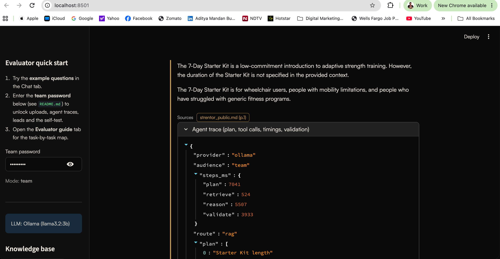
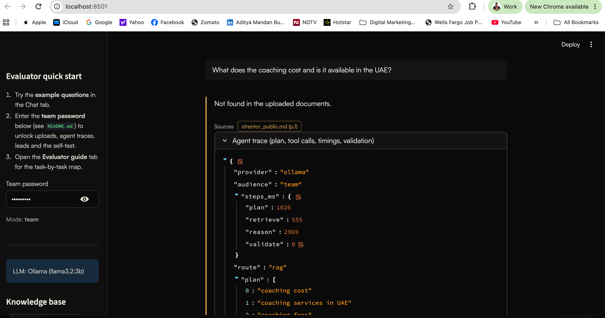
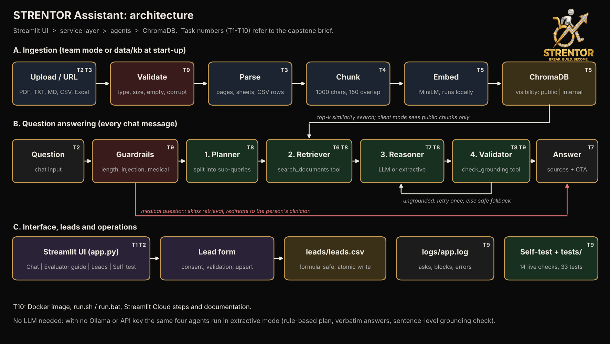

<p align="center"></p>

# STRENTOR Assistant: Documentation

Generative AI capstone: an agent-based knowledge and decision-support system that answers questions over uploaded documents using RAG, and captures leads for the STRENTOR business. Written for a reader with no prior context: concepts first, then setup, design, safety, testing and deployment.

**Contents:** 1 Overview · 2 Key concepts · 3 What users see · 4 System setup · 5 Architecture · 6 Workflow · 7 Agent roles · 8 Leads · 9 Reliability and safety · 10 Testing · 11 Deployment steps · 12 Design decisions and why · 13 Limitations and next steps · 14 Challenges faced · 15 Requirement coverage · 16 Likely questions and answers

## 1. Overview

**Problem.** STRENTOR (strentor.com) is a wheelchair-first adaptive strength coaching business. It has no inbound lead pipeline, and prospects ask the same questions about programs, eligibility and regions.

**Solution.** A Streamlit application where:
- a **client** asks questions and gets answers drawn only from public STRENTOR content, with sources;
- medical questions are redirected to a clinician, and unknown questions get a safe "not on file" reply with an invitation to contact the founder;
- interested visitors leave consented details, saved to `leads/leads.csv`;
- the **team** uploads PDF, TXT, MD, CSV or Excel files (public or internal), inspects agent traces, downloads leads and runs a self-test.

**Technology.** Python, Streamlit, ChromaDB (local vector database, MiniLM embeddings), pypdf, pandas/openpyxl. LLM backends: Ollama (local), Anthropic Claude (optional key), or built-in extractive mode (no LLM).

**The capstone link.** The brief asks for a document-based question-answering system with ingestion, chunking, a vector store, retrieval, RAG, agent-based reasoning, safety, and deployment. This project delivers each, applied to a real business use.

## 2. Key concepts

| Term | Meaning here |
|---|---|
| **RAG** (retrieval-augmented generation) | Instead of letting a model answer from memory, first retrieve the relevant passages from your documents, then answer using only those passages. Reduces invented answers and lets you cite sources. |
| **Chunk** | A piece of a document, about 1000 characters. Documents are split because a search should return the relevant paragraph, not a whole file. |
| **Embedding** | A list of numbers representing the meaning of a text. Texts with similar meaning get similar numbers. Here a small local model (MiniLM) makes them; no key or cloud service is needed. |
| **Vector store** (ChromaDB) | A database that stores chunks with their embeddings and returns the chunks closest in meaning to a question. |
| **Agent** | A step with one job and, where needed, a tool it can call. Four agents run in sequence: Planner, Retriever, Reasoner, Validator. |
| **Grounding** | An answer is grounded if every claim is supported by the retrieved text. The Validator checks this. |
| **Guardrail** | A rule that blocks or redirects unsafe input or output (injection attempts, medical questions, bad files). |
| **Visibility** | A tag on every chunk: `public` (clients may see) or `internal` (team only). |
| **Extractive mode** | A built-in way to answer with no AI model at all: pick the best-matching sentences from the documents and quote them. Lets the full pipeline run on any machine. |

## 3. What users see

**Client (default).** The STRENTOR-branded chat page. Seven example questions as buttons, a chat box, and answers with their sources. A "Talk to Aditya" form at the bottom of the sidebar. Clients can only ever retrieve public content.

**Team (password in `.env`, default `evaluator`).** Everything above plus:
- click **Load sample documents** (four demo files already in the `sample_docs/` folder, nothing to download), or upload PDF, TXT, MD, CSV, XLSX files and tag each public or internal, or ingest a web page URL (needs internet; try `https://www.strentor.com`, indexed as public; pages that need JavaScript to show text cannot be read);
- an **Agent trace** under every answer showing the plan, the tool calls, timings and the grounding verdict;
- a **Leads** tab with the table and a download button;
- a **Self-test** tab that runs 14 live checks;
- clear the index.

**Evaluator guide tab.** The architecture diagram and the task-by-task map, so a marker can navigate without contacting the author.

## 4. System setup

**For the assessor: nothing to set up.** Open the live link, or run `./run.sh` / `run.bat`, and use the password `evaluator`. Everything below the quick start is optional background (how the author ran a real LLM, and how the live app is maintained); the results are already shown in the screenshots.

**Requirements:** Python 3.9 or newer; internet on first run only (embedding model download, about 80 MB).

**Quick start**
```
Mac/Linux:  ./run.sh
Windows:    run.bat
Docker:     docker build -t strentor-assistant . && docker run -p 8501:8501 strentor-assistant
Manual:     python -m venv .venv && source .venv/bin/activate
            pip install -r requirements.txt
            cp .env.example .env
            streamlit run app.py
```
The app opens at http://localhost:8501.

**Configuration (`.env`, template in `.env.example`)**

| Variable | Meaning | Default |
|---|---|---|
| `TEAM_PASSWORD` | Unlocks team mode. Empty disables it | `evaluator` |
| `LLM_PROVIDER` | `auto` (Ollama if running, else Claude if `ANTHROPIC_API_KEY` is set, else extractive), `ollama`, `anthropic`, `gemini`, `groq`, `openai`, `extractive`. Gemini and Groq are never chosen by `auto`; set them explicitly | `auto` |
| `LLM_API_KEY` | Key for `gemini`, `groq` or `openai` (free keys exist for Gemini and Groq) | empty |
| `ANTHROPIC_API_KEY` | Enables the Claude backend (also `pip install anthropic`) | empty |
| `OLLAMA_MODEL` | Local model name | `llama3.2:3b` |

**Optional, not required (the author has already run this; see the evidence below): the AI model at work with Ollama.** By default the app runs in extractive mode, which shows the full agent pipeline without an LLM. To see generated answers and check that the AI path works:

1. Install Ollama from https://ollama.com/download and open it.
2. In a terminal run `ollama pull llama3.2:3b` (about 2 GB, one time).
3. Start the app with `./run.sh` (macOS/Linux) or `run.bat` (Windows). The terminal should say it found the Ollama model.
4. Enter the team password, click **Load sample documents**, and ask "How long is the Flagship programme and who is it for?".
5. Open **Agent trace** under the answer. Check `"provider": "ollama"`, the `plan` (sub-queries), `tool_calls`, per-step timings, and `validation`, whose method should read "lexical support check". The model's own verdict is recorded there as `judge_opinion`.
6. On the **Self-test** tab, run the live checks.

**Evidence from a real run** (Ollama `llama3.2:3b`, team mode, on the author's Mac):



*Figure: a fluent generated answer, cited to `strentor_public.md`. The trace shows `provider: ollama`, the plan, and per-step timings (plan 7.0 s, retrieve 0.5 s, reason 5.5 s, validate 3.9 s).*



*Figure: asked for UAE pricing, which the knowledge base does not state (it gives availability and a per-session rate for India only), the system answers "Not found in the uploaded documents." instead of inventing a figure. This is the guardrail working. The validator step took 0 ms because there was nothing to validate.*

### Operator notes: live deployment, free AI model and upkeep (for the project owner; not needed to evaluate)

The public app is https://strentor-assistant.streamlit.app/ (Streamlit Community Cloud, deployed from a GitHub repo). Nobody who evaluates it needs a key or an account.

**A. Deploy or update**
1. Put the project in a GitHub repo (keep `.env` and `data/chroma*` out of it).
2. At share.streamlit.io choose **Create app**, pick the repo, branch `main`, main file `app.py`.
3. Streamlit redeploys automatically whenever the repo changes. To force it: **Manage app > Reboot app**.

**B. Settings and secrets** (app **Settings > Secrets**, never in the repo or the zip)
```
TEAM_PASSWORD = "evaluator"
LLM_PROVIDER = "gemini"
LLM_API_KEY = "<free key>"
```
Without the last two lines the app runs in extractive mode (no model).

**C. Free AI model (no card).** Google Gemini and Groq both give free API keys.
1. Gemini: sign in at aistudio.google.com, click **Get API key > Create API key**. Groq: create a key at console.groq.com and use `LLM_PROVIDER = "groq"`.
2. Add the key as in B. The default Gemini model is `gemini-3.8-flash` (the model named in Google's OpenAI-compatibility documentation when this was written); if the provider rejects it, set `LLM_MODEL` to a current model name from Google AI Studio.
3. The sidebar then shows "LLM: Gemini (free API tier)". Any other OpenAI-compatible service works with `LLM_PROVIDER=openai`, `LLM_BASE_URL` and `LLM_MODEL`. Paid Claude works with `LLM_PROVIDER=anthropic`, `ANTHROPIC_API_KEY` and `pip install anthropic` (the only backend that needs an extra package; Ollama, Gemini and Groq need none).
4. **Economy mode (default, `LLM_ECONOMY=1`):** a question makes one model call, the answer; planning is rule-based and the grounding check is lexical, so a small free quota lasts three times longer. Set `LLM_ECONOMY=0` for the full three-call pipeline. **Automatic model switching:** the app holds a list of models per provider (`LLM_MODELS="a,b,c"` overrides it; a single `LLM_MODEL` goes first). If a model answers `429 quota exceeded` or is unknown (404), the next one is used at once and the bad one is skipped for a while (2 minutes for a quota error, 1 hour for an unknown name). A rejected key stops the chain. The trace shows which `model` answered, and if every model fails, team mode shows each model's error above the answer. The built-in Gemini list names model families (3.8, 3.6, 3.1 Flash-Lite, 3.5 Flash-Lite, 2.5 Flash, 2.5 Flash-Lite, 3 Flash), taken from the owner's AI Studio **Rate Limit** page. At run time the app asks Google which model IDs the key can use (`/models`, cached for an hour), maps each family to the real ID (for example one ending in `-preview`), skips image/audio variants and drops names the key cannot use. A model that reports a per-day quota is skipped for an hour. Other keys can differ; set `LLM_MODELS` to override. Free tiers are rate-limited (about 10 requests a minute as far as I know), and Google may use free-tier prompts to improve its products; that is acceptable because the knowledge base is public content. `MAX_QUESTIONS_PER_SESSION` (default 40) limits use per visitor.

**D. What happens when the model is unavailable.** If the quota is used up, the key is wrong or the network fails, the Reasoner falls back to extractive mode, so the visitor still gets a cited answer and never a crash. The grounding checks and refusals apply in every mode.

**E. Keeping the free app awake.** Streamlit's free tier hibernates idle apps, and a plain page request does not wake them. A scheduled GitHub Action (`.github/workflows/keep-alive.yml`; a visible copy is in `github_workflow_copy/`) opens the app in a headless browser every 6 hours and clicks the wake-up button if needed. To enable it, create `.github/workflows/keep-alive.yml` in the repo (**Add file > Create new file**, type the full path, paste the file, commit), open the **Actions** tab, and run **keep-alive > Run workflow** once. A green tick confirms it. If a visitor still sees "Yes, get this app back up!", clicking it restarts the app in about 30 seconds.

**F. Check after any change.** Open the live link in a private window, ask one example question, and (team mode) confirm the trace shows the expected `provider`. For a broader check run `python scripts/eval_questions.py`; it asks 37 differently-worded questions and reports how many were answered correctly.

Other settings (chunk size, top-k, limits) are in `src/config.py`. Tested versions: Python 3.13, chromadb 1.5.9, streamlit 1.66.0, pandas 3.0.5, pypdf 5.9.0.

## 5. Architecture



**Components**

| Layer | Module | Responsibility |
|---|---|---|
| Interface | `app.py` | Chat, example questions, uploads, lead form, Leads and Self-test tabs, evaluator guide |
| Service | `src/service.py` | Entry points for the UI; logging; error handling and friendly error hints |
| Agents | `src/agents.py` | Planner, Retriever, Reasoner, Validator; tool-call trace and timings |
| LLM and prompts | `src/rag.py` | Ollama / Claude calls with retry and backoff; grounding prompt; extractive answers |
| Ingestion | `src/ingestion.py` | File validation, parsing, chunking, URL fetch |
| Vector store | `src/vectorstore.py` | ChromaDB persistence, exact cosine search for small knowledge bases, public/internal filter |
| Safety | `src/guardrails.py` | Question validation, injection filter, medical detection |
| Leads | `src/leads.py` | Validation, consent, pathway suggestion, CSV upsert |
| Brand | `src/theme.py`, `.streamlit/config.toml` | STRENTOR look from strentor.com: near-black `#0A0A0A`, gold `#C99C53`, off-white `#ECE8DF`, Satoshi font, official logo bundled in `assets/` |
| Quality | `src/selftest.py`, `tests/` | Live self-test (14 checks), automated tests (50) |

## 6. Workflow

**A. Ingestion** (on start for `data/kb/`, on upload or "Load sample documents" in team mode)
1. Validate: allowed type (`.pdf .txt .md .csv .xlsx .xls`), under 20 MB, not empty, parseable.
2. Parse: PDF per page (line-wraps re-joined), Excel per sheet and CSV in 20-row blocks, text as one record.
3. Chunk: about 1000 characters with 150 overlap, preferring paragraph and sentence boundaries.
4. Embed with the local MiniLM model and upsert into ChromaDB with metadata `source`, `page` (or `Sheet:row`) and `visibility` (`public` or `internal`). Upserts use content hashes, so re-ingesting never duplicates.

**B. Question answering** (each chat message)
1. Guardrails: empty, too long (over 1000 characters) or injection-like questions are blocked. Medical questions skip retrieval and return a clinician redirect.
2. Planner splits compound questions into up to three sub-queries.
3. Retriever runs similarity search for each sub-query (client audience: public chunks only), dedupes and ranks.
4. Reasoner drafts an answer from the retrieved context only, with `[source, page]` citations.
5. Validator checks every claim is supported; if not, the Reasoner retries once; if still unsupported, a safe fallback is returned.
6. The UI shows the answer, sources, and (for buying-intent questions) a prompt to use the lead form. Team mode also shows the trace.

**Example trace** (team mode, extractive backend, real output from the test environment) for *"How long is the Flagship programme and who is it for?"*:
```json
{
  "provider": "extractive", "audience": "team", "route": "rag",
  "plan": ["How long is the Flagship programme and who is it for?", "How long is the Flagship programme", "who is it for"],
  "tool_calls": [
    {"tool": "search_documents", "query": "How long is the Flagship programme and who is it for?", "audience": "team", "hits": 5},
    {"tool": "search_documents", "query": "How long is the Flagship programme", "audience": "team", "hits": 5},
    {"tool": "search_documents", "query": "who is it for", "audience": "team", "hits": 5},
    {"tool": "check_grounding", "provider": "extractive"}
  ],
  "chunks": 7,
  "validation": {"grounded": true, "checked_sentences": 1, "issues": "", "method": "verbatim-sentence check"},
  "retries": 0
}
```

## 7. Agent roles

| Agent | Job | With an LLM | Without an LLM (extractive mode) | Tool used |
|---|---|---|---|---|
| **1. Planner** | Decide what to search for, and restate the question in the knowledge base's own words | LLM returns up to 3 sub-queries, told STRENTOR's terms; the rule-based rewrite is always added | Rule-based split on "and", "also", "?" and ";", plus a rewrite (typos repaired, slang mapped to STRENTOR terms) | `query_understanding` |
| **2. Retriever** | Fetch the most relevant content | Multi-query similarity search, dedupe, rank | Same | `search_documents` (ChromaDB) |
| **3. Reasoner** | Write the answer | LLM answers from context only, cites sources, no medical advice, no invented prices | Picks the best-matching sentences (focus-word weighting; shows the answer under an FAQ question line) with citations | none |
| **4. Validator** | Prevent hallucination | LLM fact-checker (claims supported, no medical advice, no result guarantees) | Every answer sentence must appear verbatim in the retrieved context | `check_grounding` |

**Handling loosely worded questions.** Visitors do not phrase things like the documents do ("how much for training in dubai", "is ther a prgram for compnies"). `src/query_understanding.py` repairs typos against the knowledge base's own vocabulary, maps paraphrases and slang to STRENTOR's terms (cost, fee, rate to price per session; Dubai to UAE; company, HR, CSR to corporate programmes; trial, where do I start to Assessment), and adds that rewrite as an extra retrieval query. The mapping is visible in the agent trace as `understood`. The answer step also weights the rare words a visitor typed: "what are corporate modules" is answered with the one sentence that addresses it ("Corporate and institutional programmes have no fixed module list") instead of generic corporate text, and the LLM prompt tells the model to say so plainly when a question assumes something the context denies. If nothing can be answered, the app shows "Did you mean..." buttons with the closest questions it can answer.

Control flow: Validator fails, then the Reasoner retries once with the issue appended; if it still fails, the answer is replaced by a safe fallback. Medical questions bypass all four agents.

**Why four.** Each agent has one responsibility, so each can be tested and explained separately, and the Validator is independent of the writer. Checking your own work is weak; a separate check is stronger.

**AI model options.** Local Ollama (free, used for the screenshots in section 4), a free Gemini or Groq key (used for the hosted app, which cannot run Ollama), Anthropic Claude (paid), or none. Ollama stays fully supported: on a computer where Ollama is running, `LLM_PROVIDER=auto` (the default) or `ollama` uses it. The screenshots remain valid evidence of the Ollama path, and the same four agents and grounding rules run on every backend.

## 8. Leads

The sidebar form asks for name, email, optional phone, country and what the person is looking for. It requires consent. On submit the app validates the fields, suggests a program pathway from the text of the need and the last question (Corporate & Institutional, Strategy Session, STRENTOR Circle, the free STRENTOR Assessment, or STRENTOR Flagship: Founding Cohort), and writes a row to `leads/leads.csv`. A repeat email updates its row instead of adding a duplicate, and writes are atomic so a crash cannot corrupt the file. The team views and downloads leads in the Leads tab.

## 9. Reliability and safety

| Risk | Control | Where |
|---|---|---|
| Bad, huge, empty or corrupt files | Type, size (20 MB), empty and parse checks with clear errors | `ingestion.validate_file`, `load_file` |
| Invalid questions | Empty and over-length rejected | `guardrails.validate_question` |
| Prompt injection (question or document) | Pattern filter on questions; instruction-like text removed from retrieved context; context labelled as data | `guardrails.py`, `rag.format_context` |
| Hallucination | Context-only prompt, `NOT_FOUND` rule, Validator with one retry and safe fallback, verbatim grounding check in extractive mode | `rag.py`, `agents.validator` |
| Unsafe medical output | Keyword guardrail short-circuits to a clinician redirect; prompts forbid medical advice and result guarantees; Validator checks both | `guardrails.is_medical`, `agents.run` |
| Leaking internal content to clients | `visibility` metadata filter inside the vector query (not just the prompt) | `vectorstore.search` |
| LLM or network failure | Retry with exponential backoff, timeouts, friendly error text with a hint for first-run download problems | `rag.llm`, `service.ask` |
| Lead data quality and abuse | Consent required, email and country validated, length limits, formula injection (`=`, `+`, `-`, `@`) escaped, atomic file write | `leads.py` |
| Unauthorised team access | Password gate; disabled when no password is set | `app.py`, `config.py` |
| Traceability | Every ask, block, ingest, lead and error is written to `logs/app.log` | `service.py` |

## 10. Testing

**Evidence of generated, cited answers.** Two screenshots from a real run with a local Ollama model (llama3.2:3b) are in section 4 ("Evidence from a real run"): a fluent answer with its source citation and agent trace, and a refusal when the knowledge base does not support an answer. The image files are in `docs/screenshots/`.

- **Automated tests (50):** `python -m unittest discover -s tests -v` (40 logic tests in `test_core.py`, 10 headless UI tests in `test_ui.py` using Streamlit AppTest). They cover loosely worded questions (typos, slang, paraphrase), all four file formats, Excel sheet and PDF page labels, bad files, chunk bounds and overlap, guardrails, lead rules, audience isolation, the planner, validator rejection of an invented sentence, tool-call trace, medical, blocked and out-of-scope routes, the self-test, and the UI (example questions, back-to-examples button, team-password gate, lead form, self-test, sample loading). They run offline using a stand-in word-hash embedding and extractive mode, so no model download or key is needed.
- **Live self-test (14 checks):** team mode > Self-test tab. Runs against the real embedding model, vector store and agents.
- **Manual script:** `SAMPLE_QUESTIONS.md` lists questions per sample file with expected results.
- **Not covered by automated tests:** live Ollama, Claude, Gemini and Groq backends (they need a model or key; the Gemini/Groq request format is tested against a local mock server), and answer quality with real embeddings beyond the self-test's in-scope question.

## 11. Deployment steps

**Option A: local** (see section 4). **Option B: Docker** (image pre-downloads the embedding model, so it also runs offline).

**Option C: Streamlit Community Cloud** (public link)
1. Create a GitHub repository (private is fine) and upload the project. Do **not** upload `.env`, `chroma_db/`, `logs/`, `leads/*.csv` or `data/uploads/*` (all listed in `.gitignore`).
2. Go to share.streamlit.io, sign in with GitHub, click **New app**, choose the repository and set the main file to `app.py`.
3. Open **Advanced settings > Secrets** and add `TEAM_PASSWORD = "choose-a-strong-password"` (and optionally `ANTHROPIC_API_KEY` plus `LLM_PROVIDER = "anthropic"`; add `anthropic` to `requirements.txt`).
4. Click **Deploy** (a few minutes; the first start also downloads the embedding model).
5. Smoke-test the live URL: ask an example question, submit a test lead, unlock team mode, run the Self-test, download `leads.csv`.

**Production notes.** Do not publish the default `evaluator` password on a public site (it would expose the Leads tab). Free hosting has an ephemeral disk: the public knowledge base re-seeds from `data/kb/` on every start, but uploads and `leads.csv` can be lost on restart, so download leads regularly or move storage to a database.

## 12. Design decisions and why

- **Local embeddings.** No key, no cost, no data leaving the machine. Trade-off: a one-time model download of about 80 MB.
- **Extractive fallback.** An evaluator with no AI key or model can still see all four agents work. Trade-off: answers are quoted sentences, not fluent prose.
- **Visibility in the query.** A prompt can be talked around; a database filter cannot.
- **Retry once, then fall back.** Gives the writer a chance to fix a problem without risking an endless loop or a wrong answer.
- **Streamlit.** The fastest route to a clean, deployable interface in pure Python.
- **Small modules.** One responsibility per file, so a marker can read any part in minutes.
- **Python 3.9 and newer.** Works on a default Mac without installing anything extra. Verified by running the full test suite on Python 3.9.
- **Honest scope.** Limits are documented rather than hidden.

## 13. Limitations and next steps

- **Extractive mode** returns cited sentences, not fluent prose, and cannot combine facts across sentences. LLM mode (Claude or Ollama) is recommended for fluent answers.
- **Keyword guardrails** (medical and injection) are not exhaustive. A medical question phrased without the listed keywords can pass; a determined attacker can evade the injection patterns.
- **Scanned PDFs** (images without a text layer) are not OCR'd. Spreadsheets are indexed as text rows; there is no numeric aggregation.
- **Ephemeral storage** on free hosting (see section 11). Leads are stored in a CSV, not a database.
- **Single password** for team mode, no per-user accounts or audit of who uploaded what.
- **Validator cost:** the LLM validator adds latency and extra calls. Small local models can return malformed JSON; the validator then fails open and the answer is flagged as unchecked.
- **Language:** prompts and keyword filters are English-only.
- **Font:** Satoshi loads from Fontshare at runtime; offline it falls back to a system font. The logo is bundled in `assets/`, so it always shows.
- **Public knowledge base** (`data/kb/strentor_public.md`) is a summary of strentor.com at build time; re-ingest pages when the site changes.

**Next steps, in order of value.**
1. Connect an AI model (Claude or Ollama) for fluent answers.
2. Store leads in a database or send them to a CRM.
3. Add per-user logins and an upload audit.
4. Add OCR for scanned PDFs.
5. Re-ingest strentor.com automatically on a schedule.
6. Put the assistant on strentor.com itself (see below).

**Website integration (future work).** The Streamlit app is a demonstration and review tool, so it is not embedded in the live site. For visitors, I designed a separate website chat widget for the production site (Next.js on Vercel): a floating launcher that opens a proactive, page-aware greeting once per visitor, quick-reply buttons, answers from the same kind of grounded public knowledge, the same refusals for medical questions and prompt injection, and an inline lead form that saves the lead and emails the owner. It reuses this project's design: guardrails before the model, answers limited to public content, no prices quoted (it points to the pricing page), and a consent step before any details are collected. It is a prototype on a separate branch and is not part of this submission. Its pure logic (guardrails and canned answers) has 12 unit tests, and its interface was checked in a browser on desktop and mobile, but the lead email and database path have not yet been tested end to end.

## 14. Challenges faced and how they were handled

Written in my own words, in the order I hit them.

**1. Keeping internal partner information away from clients.** My first idea was a rule in the prompt: "never reveal internal documents". I then realised a prompt can always be talked around. So I moved the rule into the database query itself: a client search can only match chunks tagged `public`. I wrote a test that stores an internal fact and proves a client search cannot retrieve it. Lesson: put security in code, not in instructions.

**2. Working without an AI key.** An evaluator might have no API key and no local model, and a project that only runs with one would fail on first contact. I built an "extractive" mode where the same four agents run without a model: a rule-based planner, sentence selection, and a real grounding check (every answer sentence must appear word for word in the sources). The first results were poor. The assistant returned the FAQ question line instead of its answer, markdown symbols leaked in, and PDF line breaks cut sentences in half. I fixed these one by one: show the answer under the matched question, weight the question's key noun, strip markdown, drop weak matches, and re-join wrapped PDF lines.

**3. Testing a system that downloads a model.** The embedding model has to be downloaded once, and my build environment blocked that download. I tested with a small stand-in embedding (word hashing) so all 50 tests run offline, and I put checks against the real model into the in-app Self-test. Once deployed, I confirmed the real model on the live app: answers are grounded and the Self-test passes. The evaluator can re-run the Self-test in one click.

**4. Spreadsheets in a text search.** CSV and Excel rows mean little as plain text. I turned each row into `column: value` pairs, grouped 20 rows per chunk, and kept the sheet name so the citation reads `Regions:1`.

**5. Python version differences.** My Mac runs Python 3.9, and the first version of the project refused to start there because I had used newer type-hint syntax. I fixed it with one import per file, loosened the run scripts to pick the best Python available, and ran the full test suite on a real Python 3.9 to prove it.

**6. A chat that feels natural in Streamlit.** Streamlit reruns the whole page on every click. Early on the example buttons stayed visible after a question, new messages appeared below the input box, and there was no way back to the examples. I restructured the flow so the answer is computed first and the page is redrawn once, and I added a "Back to examples" button with a test.

**7. Validator strictness.** A strict checker rejects good answers. A lenient one lets inventions through. I settled on one retry with the checker's complaint passed back to the writer, then a safe "not on file" fallback, and a clear "unchecked" flag if a small local model returns broken output.

**8. Branding and leads without being intrusive.** I needed the STRENTOR look without breaking offline use, so the official logo is bundled in the project and only the font loads from the internet. For leads, I required explicit consent, only mention the form when a question shows buying intent, escape spreadsheet formulas in the CSV, and update a lead by email instead of duplicating it.

**9. Free hosting forgets files.** On free hosting the disk resets on restart. The public knowledge base re-seeds itself at start-up, leads can be downloaded from the Leads tab, and I document the limit and the database upgrade path.

**10. A real website behaves differently from my test pages.** Loading https://www.strentor.com first answered "Not found" because the site's figures (for example, the number of regions) sit in separate fragments from their labels, and my strict matching rejected them. I glued number fragments to their labels during ingestion, allowed a weaker word-match fallback when the embedding score is low, and added match scores to the agent trace so the cause is visible. Lesson: test on the real site, not only on sample files.

**11. First deployment failures.** Streamlit Cloud first reported that the branch and file did not exist because my upload had not been committed on GitHub. After that, team mode showed as disabled because the `TEAM_PASSWORD` secret was missing. I committed the files and added the secret, then checked the live app end to end.

**12. Documentation that looks as good as the product.** My PDF had white bands in the page margins that cut the first and last lines, and table rows split across pages. I painted a brand-dark layer under every page, stopped rows splitting, and re-checked all 11 pages visually.

**13. An intermittent test failure that was a real defect.** One security test (a client must never see internal content) failed about once in 25 runs. The cause was not the filter: Chroma's approximate index occasionally missed an exact match on a very small collection. For a few dozen chunks an approximate index buys nothing, so search is now exact (a plain cosine comparison) up to 2,000 chunks, still applying the public/internal filter inside the query. I reran the suite more than 60 times to confirm.

**14. A small local model rejected its own good answers.** With Ollama (llama3.2 3B) the app answered "I could not produce a fully grounded answer" to a simple question. The Validator asked the same small model to judge the answer, and a 3B model is an unreliable judge. I changed the Validator for local models: a deterministic check now decides (each answer sentence must have at least 60% of its content words in the retrieved context), and the model's own opinion is recorded in the trace as advisory only. Claude keeps the LLM fact-check. A new unit test covers a supported and an invented answer.

**15. "Not found" from a local model that had the answer.** Ollama defaults to a 2,048-token window. My prompt (instructions plus ten retrieved chunks) was longer, so the model silently lost the start of it and answered "Not found". I now ask Ollama for an 8,192-token window (`OLLAMA_NUM_CTX`) and send only the top five chunks. A unit test checks the request carries the larger window.

**16. Visitors do not phrase questions like the documents.** "What does the coaching cost and is it available in the UAE?" returned "Not found" on a real Ollama run, and exact-wording matching would fail on typos and slang for the same reason. I added a query-understanding step in the Planner (typo repair, paraphrase to STRENTOR terms, an extra rewritten search query) and "Did you mean" suggestions when nothing matches. Five new test checks cover it, including a question whose premise is wrong ("what are corporate modules": corporate programmes have no fixed modules). Measured limit: on 37 differently-worded questions not used for tuning (`scripts/eval_questions.py`), offline extractive mode answers 27 correctly (73%), and all three off-topic questions are refused. Free paraphrase ("can I do it on my own schedule") is where it still fails, because extractive mode selects sentences by words; a generative backend (Ollama or Claude) is what handles open wording, and the same script can be run against it. The mapping is also a hand-written glossary for this business, so a new product needs new entries; with an LLM backend the Planner also rewrites the question itself.

**17. A corrupted model cache on the live app.** The deployed app showed "Could not load the public knowledge base ... INVALID_PROTOBUF". The embedding model had been cached from a half-finished download, so every start failed on the same broken file. The app now recognises that error, deletes the cached model, downloads it again and retries once; any other error is still raised. Two unit tests cover the repair and that other errors are not swallowed.

**18. A hosted model that is slow or rejects requests must not hang the app.** After switching to a hosted model the Self-test ran for minutes: each agent retried a failing call three times with waits. A rejected request (bad key, unknown model) is now not retried, one failed call pauses the model for two minutes so every agent falls back to extractive mode at once, and the Validator checks extractive answers word for word. Two tests cover it, including a Self-test that must finish in under 20 seconds with the model down.

**19. "Tell me about corporate program" gave a thin answer.** The visitor's spelling ("program") differs from the site's ("programme"), and "corporate" was missing from the word map, so the search pulled generic Flagship text and the site's own description of the corporate service was left out. Spellings are now unified (programme = program, organisation = organization), "corporate" maps to the corporate service, and a generic Flagship term is no longer added when a specific offer is named. A test checks both spellings. Re-measuring after this change gives 27 of 37 on the held-out set (one answer that had matched by luck is now an honest refusal).

**20. A silent fallback hid a failing model.** On the live app the sidebar said Gemini, yet answers looked like extractive bullets. The model call was failing and the safe fallback (see 18) was working so quietly that nothing showed it. The trace now records `answer_mode` (generated, extractive, or extractive-fallback) and `llm_error` with the provider's own message, and team mode shows a warning above the answer. A test checks that a fallback is reported. Related change: re-ingesting a file replaces its old chunks, so an old persisted index cannot leave stale text behind. (I also tried splitting the knowledge base by topic; it scored lower on the held-out set, so I reverted it.)

**21. Free quota used up three times too fast.** The live app answered with Gemini's `429 You exceeded your current quota`. Each question made three model calls (plan, answer, validate), and the Self-test and my own checks made more. With a hosted free model the app now runs in economy mode: one call per question, rule-based planning, a lexical grounding check, and no retries on a 429. A test checks that one question costs exactly one request. Limit: the validator in this mode is a word-support check, weaker than a model judge, and the answer and its sources still pass the same guardrails.

**22. One model's quota should not end the answer.** Gemini's free quota is per model, so when one model returned 429 the app fell back to extractive mode even though another model had quota. The hosted-model call now walks a chain of models, switching at once on a 429 or an unknown model, remembering which are cooling down, and reporting which model answered. A test uses a mock server where the first model is over quota and checks the second answers and the first is then skipped.

**23. Model IDs differ from display names.** AI Studio shows names like "Gemini 3.6 Flash", while the API ID can carry a suffix. Hard-coding IDs would fail silently on 404. The app now lists the key's real model IDs, maps family names to them and drops unknown ones; a test with a mock server checks the mapping, including skipping an image variant.

## 15. Requirement coverage

All ten capstone tasks are mapped to files and one-minute checks in [`TASK_MAP.md`](TASK_MAP.md). Submission requirements: complete source code and this documentation (setup, architecture, agent roles, deployment steps, limitations, challenges) are included in the zip.

## 16. Likely questions and answers

**Why RAG instead of a plain chatbot?** Answers come from approved documents and can cite them. A plain model answers from memory and can invent prices or claims.

**How do you reduce hallucination?** Context-only prompt, a "not found" rule, a separate Validator with one retry, and a safe fallback. In extractive mode the check is exact: a sentence must appear verbatim in the sources.

**Why is the Validator a separate agent?** A writer reviewing its own output tends to approve it. Separation makes the check meaningful and testable.

**How is internal data protected?** By a visibility filter inside the vector query. Clients never retrieve internal chunks, and a test proves it.

**What if there is no API key?** Extractive mode runs the same four agents with no model. The architecture is identical; only the wording step differs.

**Why chunk with overlap?** So a fact that falls at the end of one chunk still appears in the next.

**How would this scale?** Replace the CSV with a database, move ChromaDB to a server, add authentication, and run the app in a container behind a load balancer. The module boundaries already separate these concerns.

**What would you improve first?** Connect a real language model and move leads to a database.

**How do you know it works?** 50 automated tests, a 14-check live self-test, and a manual question script, all runnable by the marker in minutes.
